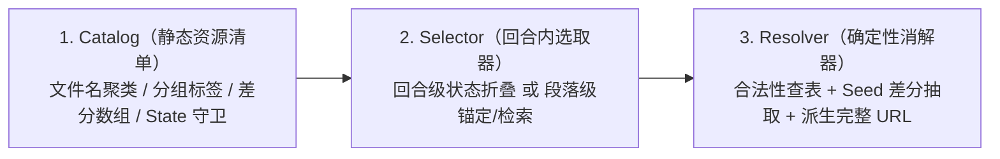

# 卡片静态资源目录与附件插件提案（Catalog & Attachment Plugins）

2026-10-25。本篇探讨如何从更高一层的「资源目录（Catalog）+ 生命周期挂载（Selector）+ 确定性消解（Resolver）」插件抽象，统一解决插图卡、BGM 音乐播放器、台词语音包、证物/图鉴解锁等多媒体与附件卡需求，而不污染核心状态机与主笔上下文。

---

## 1. 为什么不能靠「世界书塞表 + 正则替换」解决？

以酒馆生态中成熟的插图卡制作规范（如《π的插图教程 — 插图卡制作SOP》）为例，创作者为了在单次请求、无插件底座的酒馆里实现一套 160 张规模的插图卡，不得不手动完成以下工程：

1. **自建统一前缀图床（Cloudflare R2）与严格文件命名**：将图片命名为 `<分类标签>-<具体内容>.png`（如 `小明-吃饭1.png`、`小明-吃饭2.png`），消灭随机哈希文件名带来的模型幻觉。
2. **用本地 Python 脚本把文件名编译成世界书文本**：扫描目录，按前缀聚类成数千 Token 的 `<illustration_list>` 纯文本块；因体积过大（50～160 张图常占 7000～8000 字），还必须拆成 `after_char`（蹭前缀缓存放总表）与 `d0`（深层放简短召回指令）两条世界书。
3. **靠正则与 `{{random}}` 做差分映射**：将 `小明-吃饭1/2` 在提示词里合并为一个语义键 `《小明-吃饭》`，再靠正则替换为 `https://.../$1{{random::1::2}}.png`。
4. **专门占用一个开场白做「图库测试」**：把整张 `<illustration_list>` 塞进一个 `first_mes`，既给玩家当 CG 画廊看，又供作者肉眼排查死链和格式错误。

这套 SOP 已经把纯上下文工程推到了极限，但依然面临四道无法靠提示词跨越的硬伤：

- **上下文与注意力税（$O(N)$ Token 常驻）**：主笔模型（`narrate`）每一轮写正文时，都要在几百个文件名里做精确字符串匹配，既要兼顾文学描写，又要数够 2～3 张图、卡准段落位置、一字不差地默写键名。
- **全量暴露，缺乏状态与场景粗筛**：160 张图里大半受限于特定角色、服装、地点或好感阶段，但常驻世界书把当前绝不可能出现的条目也一并塞进了上下文。
- **正则差分的刚性限制**：单条 `$1{{random::1::2}}.png` 要求所有带差分的图数量一致（否则得按差分张数拆多套规则），且渲染期随机每次刷新都会跳变，无法绑定回合种子稳定回放。
- **幻觉零兜底**：模型一旦拼错一个字（如把 `《优菈-挥剑》` 写成 `《优菈-拔剑》`），前端直接渲染出裂图。

---

## 2. 往上一层看：为什么它应该是一个「Catalog 附件插件」而非通用预装项？

插图卡本身是特定品类的玩法，不应把 `illustrations` 硬编码成每张 `Card` 必带的顶层字段。

如果我们站高一层看：**插图卡、带 BGM 的音乐播放器、环境音效包、甚至推理卡里的「证物/图鉴弹出卡片」，本质上全都是同一件事——给卡片外挂一份静态资源清单（`Catalog`），并在回合生命周期中按规则挑出条目、消解为节点附件。**

将这层能力抽象为可插拔的 **Catalog Attachment Plugin**，能同时达成两个目标：

1. **底座保持极简**：不挂插件的普通文字卡对这套机制完全零感知、零额外开销。
2. **一套骨架通吃所有多媒体/附件形态**：插图卡只是官方提供的第一个内置插件示例（Preset Plugin），创作者可以按完全相同的接口挂载音乐播放器、语音包或图鉴系统。

---

## 3. 插件的三段式架构：`Catalog → Selector → Resolver`

任何一个资源附件插件都由以下三个正交部分组成：



### 3.1 `Catalog`：作为数据的静态资源清单（加载期）

取代手写几千字的世界书列表，插件接收结构化的资源声明，或直接通过辅助函数（相当于把教程里的 `classify_images.py` 内置为标准构造函数）从文件名列表自动构建：

```ts
export interface CatalogItem {
  id: string                  // 语义键，如 "优菈-挥剑" 或 "bgm-酒馆-夜雨"
  group?: string              // 分类前缀/角色标签，如 "优菈"
  tags?: readonly string[]    // 检索用语义标签
  variants: readonly string[] // 相对路径或文件名数组，如 ["优菈-挥剑1.png", "优菈-挥剑2.png"]
  when?: Cond                 // 可选：受卡片 State 控制的可用性守卫（同 Action.when）
  meta?: Readonly<Record<string, string | number>> // 可选元数据（曲名、时长、图注等）
}

export interface Catalog {
  id: string                  // 目录标识，如 "cg" | "bgm" | "codex"
  kind: "image" | "audio" | "card"
  baseUrl: string             // 统一资源前缀，如 "https://pub-xxx.r2.dev/"
  items: readonly CatalogItem[]
}
```

仅靠把 `<illustration_list>` 提升为 `Catalog` 数据结构，就能立刻白拿三项脱离 AI 的工程能力：

- **自动差分聚类**：构造器 `catalogFromFiles(baseUrl, files)` 扫描到 `小明-吃饭1.png`、`小明-吃饭2.png`、`小明-睡觉.png` 时，自动按 `<group>-<name>[n].ext` 聚合成两条 `CatalogItem`，每条拥有各自独立的 `variants` 数组，彻底摆脱正则 `{{random::1::2}}` 的张数限制。
- **原生画廊 / 点唱机视图**：前端读取卡片上的 `Catalog` 即可直接按 `group` 渲染「CG 画廊」或「BGM 曲库」，无需再占用 `greetings` 槽位手搓「图库测试开场白」。
- **CLI 静态体检**：开发期一条命令即可遍历 `baseUrl + variant` 批量发起 `HEAD` 校验，在发卡前检出所有 404 死链与未对齐命名。

---

### 3.2 `Selector`：附件如何接入回合生命周期？（运行期）

不同多媒体插件的唯一区别，在于**它挂在回合的哪个粒度上**，以及**如何把候选集控制在极小范围内**：

#### 前置步：基于 `State` 与上下文的代码级粗筛（Pre-filter）
无论图库有 160 张还是 500 张，在进入当前回合前，先由纯代码过滤掉 `when` 不成立的条目（例如当前不在战斗状态，直接滤除所有战斗 CG 与战斗 BGM；某角色不在当前 `people` 在场表中，直接滤除该角色专属图）。

#### 挂载粒度 A：回合级挂载（Turn-level）—— 适用于 BGM 播放器、环境音、场景立绘
- **特征**：一整轮只需要挑 0 或 1 个条目，且沿着历史路径按 `latest` 规则折叠（当轮未切歌则延续上一轮 BGM）。
- **机制**：插件直接向 `record` 阶段动态注入一个受当前活跃 `CatalogItem.id` 约束的枚举字段（或可空枚举）。因为候选集已经过代码粗筛且运行在极低成本的 `record` 阶段，主笔 `narrate` 完全零负担。

#### 挂载粒度 B：段落级挂载（Paragraph-level）—— 适用于插图卡、台词语音、表情气泡
- **特征**：一轮正文内需在特定场景、动作或对话段落后插入 1～3 个附件。
- **机制 1：事后「配图师（Illustrator）」独立小工序（默认推荐，零上下文污染）**
  - 主笔 `narrate` 只管专心写小说，**提示词里不放任何一张图名**（省下全部 8000 字上下文与注意力）。
  - 正文生成完毕后，插件调用轻量的后置选取器（配合 `design/lifecycle-proposals.md` §4 的工序路由，直接绑定百毫秒级的 Flash / Haiku 模型）：
    - 输入：按自然段标好序号的当轮正文（`¶1 ... ¶2 ... ¶3 ...`）+ 粗筛后的可用 `Catalog` 键名表 + 创作者的配图偏好（如「角色初次登场或体态变化必配，每轮 1～3 张」）。
    - 输出：结构化锚点数组 `Array<{ afterParagraph: number; id: string }>`。
  - 因为这次短调用的输入用完即弃、**永远不进入聊天历史**，既做到了段落级精准卡位，又彻底根治了长图库对主笔文风的干扰。
- **机制 2：文内语义锚点 + 本地检索（适合追求流式边写边出图的场景）**
  - 主笔只在需要配图的段落尾输出轻量意图标记（如 `[[cg: 优菈 拔剑迎敌]]`），无需背诵精确文件名；
  - 插件在流式切分 `Part` 时截获该标记，在代码层按 `group` 前缀与 `tags` / 编辑距离检索定位到最匹配的 `CatalogItem.id`。

---

### 3.3 `Resolver`：遵守 §17 铁律的确定性消解与防裂图兜底（落盘与派生期）

`src/journal.ts` §17 规定了本项目的核心存储不变量：
> **Only LLM outputs and seeds are stored; events, state and deliveries are derived along the path.**

附件插件严格遵守这一铁律：

1. **节点只存语义 `id`，绝不存完整 URL**：
   - 回合级附件直接存在 `Turn.products`（如 `bgm: "酒馆-夜雨"`）；
   - 段落级附件作为轻量结构化记录（或非 `"text"` 的 `{ type: "attachment", catalog: "cg", id: "优菈-挥剑" }` `Part`）落盘在 `Turn` 上。
   - **收益**：因为历史记录里没有写死任何 ``，一是下一轮拼 `prose(t)` 喂给模型时天然剥离所有附件代码（0 历史污染）；二是**如果创作者日后迁移了图床域名，只需修改卡片上的 `baseUrl`，所有玩家的既有存档立刻无缝生效**。
2. **查表兜底（彻底消灭裂图）**：
   - `Resolver` 将存储的 `id` 对照 `Catalog` 解析时，若发现某条 `id` 不在清单内（例如手动编辑或非严格模式下出现的幻觉），直接静默忽略或按同 `group` 回退，前端永远不会渲染出 404 裂图。
3. **基于节点种子的确定性差分抽取**：
   - 当命中的 `CatalogItem` 含有多张差分（`variants.length > 1`）时，`Resolver` 直接复用 `src/card.ts` 的 `rollOf(seed)`（由回合种子与附件序号派生）选出唯一确定的差分文件名并拼上 `baseUrl`。
   - **收益**：不同于酒馆正则 `{{random::1::2}}` 每次刷新网页都乱跳，基于 `seed` 的差分抽取保证同一次生成在任何时候重绘、回放都稳定显示同一张差分；而在玩家触发 `swipe`（重roll，产生新节点与新 `seed`）时，又能自然切换到另一张差分。

---

## 4. 内置插件示例对照

在这套统一接口下，不同玩法只需提供薄薄一层声明辅助函数：

| 内置插件构造器 | `Catalog` 来源 | `Selector` 策略 | `Resolver` 派生结果与客户端呈现 |
| :--- | :--- | :--- | :--- |
| **`illustrations(opts)`**<br/>（插图卡插件） | `catalogFromFiles(baseUrl, files)`<br/>自动按 `<标签>-<内容>[1..n].png` 聚类 | 事后段落锚定 `Array<{ afterParagraph, id }>`<br/>（每轮上限 `maxPerTurn: 3`） | 查表 + `seed` 抽差分 → 插入对应段落下方渲染图片；卡片页生成分组 CG 画廊 |
| **`bgmPlayer(opts)`**<br/>（音乐播放器插件） | 曲目表 `{ id, group, url, when, meta: { title } }[]` | 回合级 `record` 选择当前 `id`，沿路径按 `latest` 折叠 | 查表派生音频 URL → 顶部/侧栏常驻迷你播放器，跨轮同曲目无缝续播、换曲平滑淡入淡出 |
| **`voicePack(opts)`**<br/>（台词语音/音效插件） | 角色语音/环境音效清单 | 段落级或台词级锚定 | 对应段落旁渲染小型播放按钮或流式自动触发短音效 |
| **`codexCards(opts)`**<br/>（证物/图鉴附件插件） | 线索/物品图文定义 + `when` 状态守卫 | 当回合事件或正文首次触及该条目时挂载 | 回合尾部弹出「解锁图鉴/获得证物」精美附件卡，并汇总至侧栏图鉴面板 |
