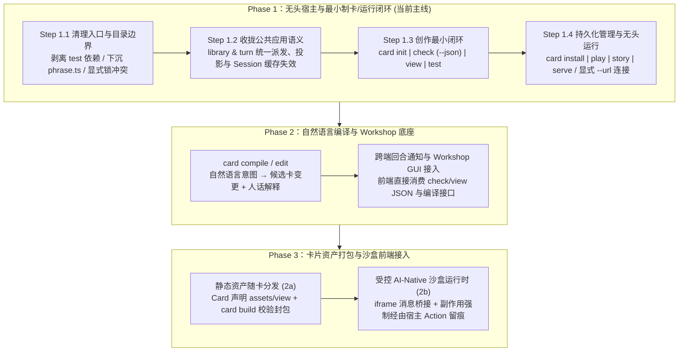

# Roadmap：Headless CLI 宿主、制卡工具链与无头运行闭环

归档状态（2026-11-08）：Step 1.1、1.2 已实现；Step 1.3 起仍为计划（追踪见 Issue #155）。

当前可用入口：`bun packages/server/src/headless.ts`；在 `packages/server` 执行 `bun run compile:headless` 可生成独立二进制。无头入口默认使用当前目录的 `.tavern/tavern.db`，支持 `DATA`、`CARDS`、`HOST`、`PORT`；`MODEL=fake` 显式启用脚本模型，否则使用库内配置的模型路由，不自动读取本机开发者凭据。HTTP 挂载于 `/api`，不提供静态前端。

模板位于 `packages/runtime/cards/`，文件加载与示例玩家配置位于 `packages/runtime/support/cards.ts`，脚本回答辅助位于 `packages/runtime/support/script.ts`。`library.cards.put` 校验并保存完整候选卡，安装定义优先于同 ID 模板；完整的 lint 安装命令仍属于 Step 1.4。运行中更新卡会标记旧 Session 过期，回合完成后的下一次访问重新加载。

验证：`vp check`、`vp run verify`；独立二进制在临时目录中建局、脚本模型游玩、重启恢复的冒烟测试。跨入口测试见 `packages/server/test/headless.ts`。

## 1. 背景与目标

目前项目已具备相当完备的 Headless 内核（[`makeSession`](../packages/runtime/src/session.ts) 状态机、[`library`](../packages/server/src/library.ts) 多故事会话与配置管理、[`turn`](../packages/server/src/turn.ts) 服务端回合生命周期、[`lint`](../packages/runtime/src/lint.ts) 静态拓扑诊断与 [`view`](../packages/runtime/src/view.ts) 阶段切片预览），但尚未收敛为一个**可脱离浏览器与开发环境假设、独立交付运行的 Headless 产品**。

将 **Headless CLI** 作为下一阶段主线，同时承载三项架构任务：
1. **检验并做实前后端解耦**：清理生产入口对测试目录（`runtime/test`）与前端构建产物（`client/dist`）的隐式依赖，将散落在 HTTP 适配层（[`serve.ts`](../packages/server/src/serve.ts)）中的并发控制与外部投影下沉为公共语义。
2. **打通纯粹的制卡工作流**：在后端与命令行率先跑通“初始化 → 解码与静态校验 → 可解释预览 → 确定性场景测试 → 入库安装”的完整闭环，为后续自然语言制卡编译器与前端 Workshop 提供确定的底层接口。
3. **为多形态前端与重度卡片留好接缝**：让终端、官方 Solid 薄客户端、第三方自定义前端以及未来的卡片自带视图（沙盒 SPA）面对同一套宿主要求与读写契约。

---

## 2. 核心设计不变式与边界约定

在演进过程中严格遵守 [`README.md`](../README.md) 的立项原则（尤其是**“核心有上限，`runtime/src/` 保持一两千行量级”**），确立以下四条边界不变式：

### 2.1 保持 `runtime/src/` 的核心职责
* **进核心（`runtime/src/`）**：保留领域计算与 Session 回合执行；不混入文件 I/O、启动配置或测试驱动。将客户端现有的纯函数规则短语模块 [`phrase.ts`](../packages/runtime/src/phrase.ts) 下沉至 `packages/runtime/src/phrase.ts`，供 CLI 与前端共同调用。
* **不进核心**：YAML 文件读写、四张内置标准模板卡（`wuxia`、`yandao`、`banxing`、`ri`）、默认玩家层配置、以及脚本化模型驱动器（原 [`test/cards/index.ts`](../packages/runtime/test/cards/index.ts) 与 [`test/script.ts`](../packages/runtime/support/script.ts)）。这些归入宿主/CLI 支撑层或独立资源目录，脱离 `test/` 目录但绝不混入 `runtime/src/`。

### 2.2 卡片更新与历史重放语义（热更新 vs 文本冻结）
* **不引入复杂的多重版本号与存档迁移引擎**。
* **明确语义**：开发与游玩中的故事按当前卡规则解释；历史节点已送达的资源文本由 [`DeliverySnapshot`](../packages/runtime/src/context.ts) 冻结保留，而派生状态（[`derived.ts`](../packages/runtime/src/derived.ts) 中的 `rpg.fold` 与 `settleReadouts`）随当前卡规则重算。
* **缓存失效机制**：当卡片在库中被写入或更新时，正在执行回合（`turn.busy !== null`）的故事继续使用原卡完成当前回合；其余绑定该卡的空闲 [`Session`](../packages/server/src/library.ts) 缓存立即失效，下次访问时按新卡重新加载。

### 2.3 数据库进程锁与双模连接边界
* **显式锁冲突（Fail-fast）**：修正 [`data.ts`](../packages/server/src/data.ts) 中 [`lock()`](../packages/server/src/data.ts) 的默认行为。正式入口（Server / CLI）遇到 `.dev/tavern.db` 被其他存活进程占用时，**直接报错并输出占用进程的 `PID` 与数据库路径**，绝不静默分流到 `<pid>/tavern.db`。
* **显式隔离**：仅当测试或后台 Agent 显式传入隔离标志（或指定独立 `DATA` 目录）时，才启用进程级隔离库。
* **本地模式与远程模式**：CLI 支持直接操作本地库（In-process）或通过显式 `--url` 连接已启动的 Server。第一阶段不假设空闲网页端在无通知机制下能自动感知终端发起的新回合（现有 [`turn.attach()`](../packages/server/src/turn.ts) 仅挂载运行中回合，空闲时返回 `204`）。

### 2.4 公共应用语义收拢（HTTP 与 CLI 行为一致）
在 [`library.ts`](../packages/server/src/library.ts) 与 [`turn.ts`](../packages/server/src/turn.ts) 收拢原本散落在 [`serve.ts`](../packages/server/src/serve.ts) 中的业务规则，确保任何入口调用具有相同的领域保证：
1. 同一非法动作被同样拒绝（统一边界 Schema 解码）。
2. 同一故事并发限制一致（`busy` 时拒绝新动作与节点删除，唯独放行针对当前结算的 `skipRecord`）。
3. 外部事件投影一致（`change` 事件统一投影为 [`TimelineNode`](../packages/runtime/src/projection.ts) 与 `updated` 列表；非 `inspect` 模式下不泄露内部 `call` 请求正文与卡片私有文本）。
4. 停止（`withdrawn` / `halted`）、失败与重连（`attach`）语义一致。

---

## 3. 分阶段演进路线图

---

### Phase 1：无头宿主与最小制卡/运行闭环（MVP）

> **阶段验收北极星**：在没有 `client/dist`、没有浏览器、没有开发者机器默认配置的环境里，通过 CLI 初始化一张卡，完成检查和预览，用脚本模型跑通场景测试，安装入库并开始一局故事，保存退出后恢复，再启动服务供其他客户端接入。

#### Step 1.1：清理入口与目录边界
- [x] **下沉 [`phrase.ts`](../packages/runtime/src/phrase.ts)**：移至 `packages/runtime/src/phrase.ts`，客户端改为从 `@effect-tavern/runtime/src/phrase.ts` 导入。
- [x] **移出生产代码对 `runtime/test` 的依赖**：
  - 将四张标准模板卡（`wuxia.yaml`、`yandao.yaml`、`banxing.yaml`、`ri.yaml`）、YAML 读取函数、默认玩家层与脚本化回答辅助移出 `test/` 目录（使 [`bin/card.ts`](../packages/runtime/bin/card.ts) 与 [`server/src/dev.ts`](../packages/server/src/dev.ts) 不再引用 `test/*`）。
- [x] **修正 [`data.ts`](../packages/server/src/data.ts) 占库冲突行为**：
  - 默认遇到锁被存活进程持有时直接抛出明确错误（含占用 `PID` 与数据库路径）。
  - 增加显式隔离参数（如 `open(path, { isolateOnBusy: true })`）仅用于自动化测试或隔离环境。
- [x] **清理构建与启动入口假设**：
  - 确保 `server` 在无 `client/dist` 时可作为纯 Headless API 服务启动与编译；提供独立的无头编译目标。

#### Step 1.2：收拢公共应用语义（[`library.ts`](../packages/server/src/library.ts) & [`turn.ts`](../packages/server/src/turn.ts)）
- [x] **统一动作派发与 `busy` 拦截**：在 `turn` / `library` 层封装动作提交入口，内置 `busy` 检查与 `skipRecord` 特例处理，[`serve.ts`](../packages/server/src/serve.ts) 仅做状态码映射。
- [x] **统一外部事件流投影**：将 [`serve.ts`](../packages/server/src/serve.ts) 的 `shown(e)` 下沉至 `library` / `turn`，统一产出对外 [`TimelineEvent`](../packages/runtime/src/projection.ts) 流。
- [x] **卡片安装/更新与 Session 缓存失效**：
  - 在 `library` 中暴露 `cards.put(card)`（内部执行 [`decodeCard`](../packages/runtime/src/card.ts) 与 [`facets`](../packages/runtime/src/session.ts) 计算，写入 `data.cards`；已安装卡优先于同 ID 的内置模板）。
  - 写入成功后，遍历 `sessions` Map，驱逐所有属于该 `card.id` 且当前 `turn.busy === null` 的缓存会话；若当前有正在运行的回合，标记其在回合结束后失效。
- [x] **补充跨入口一致性测试**：在 `packages/server/test/` 中断言直接调用 `library` 与通过 HTTP 调用在非法动作拒绝、并发冲突、事件投影脱敏及卡片热更新重算上行为一致。

#### Step 1.3：完成创作最小闭环（`card init | check | view | test`）
- [x] **`card init`**：
  - 支持按双坐标（是否有 `persona`、默认通道 `act | note`）或原型模板初始化最小可运行 `.yaml` 卡片文件。
- [x] **`card check [--json]`**：
  - 将 YAML 解析 / [`decodeCard`](../packages/runtime/src/card.ts) 阶段的结构错误统一转换为 [`Diagnostic`](../packages/runtime/src/lint.ts)（`rule: "schema"`），与 [`lint(card)`](../packages/runtime/src/lint.ts) 静态语义诊断合并输出。
  - 支持 `--json` 机器可读输出（含 `diagnostics`、字段 `drawn` 视图规格、开场预览与各节 Token 估算），作为未来 Workshop 前端的直接数据源。
- [x] **`card view [--json]`（可解释性增强）**：
  - 接入 `phrase.ts` 替代原始 `JSON.stringify(c)` 显示条件、效果与检定概率。
  - 结合当前 `state`、事件与玩家层 [`resolve`](../packages/runtime/src/layer.ts) 结果，解释为什么某段 `fiction` 未激活、为什么某条 `lore` 处于当前层或未开窗、以及哪个槽位由哪一层（`from`）生效。
- [x] **`card test`（确定性场景验证）**：
  - 定义极简的场景测试描述格式（指定 `greeting`、可选 `seed`、几步玩家输入与脚本化模型回答，断言目标 `state`、触发的 `events`、打开的 `windows` 或产出的 `products`）。
  - 复用脚本化模型驱动器在毫秒级完成离线回归校验。

实现与边界说明见 [离线制卡工具](card-cli.md)。

#### Step 1.4：接上持久化游玩与服务管理（`install | play | story | serve`）
- [ ] **`card install <file>`**：校验候选卡片文件（先跑 `decodeCard` + `lint` 无 error），通过后写入本地库 `card` 表并触发空闲 Session 缓存刷新。
- [ ] **`play` & `story`**：
  - `story list | new | show | export | delete`：在终端管理故事与分支。
  - `play`：在终端启动或继续一局故事（支持 `--model fake` 零成本试跑与真实模型路由，支持流式输出正文、执行动作、查看当前 `context` 与 `detail`）。
- [ ] **`serve`**：
  - 启动 Headless 服务（当指定静态目录或存在 `client/dist` 时可选挂载前端）。
  - CLI 运行命令支持本地直连库模式与显式 `--url <http://...>` 远程连接模式；输出遵循“普通结果支持 `--json`、流式事件支持 `--jsonl`、日志走 `stderr`”的规范。

---

### Phase 2：自然语言编译与 Workshop 后端底座（后续演进）

在 Phase 1 确定性管道跑通后接入：
1. **`card compile` / `card edit`（意图到候选卡）**：
   - 接收作者的自然语言意图（如“好感超过 60 后她会主动提起那封信，但玩家没回应时不要判成拒绝”），调用模型生成候选结构化修改（新增/调整 `fields`、`fiction` 区间、`lore` 窗口与 `readouts`）。
   - 自动通过 `phrase.ts` 生成人话解释与结构差异，并自动过 `check` 与受影响的 `test` 场景。
2. **跨端实时订阅与 Workshop 前端**：
   - 为 Server 补充故事级轻量的回合开始/变更通知流，使空闲网页与终端可实时互相同步。
   - 前端 Workshop 直接调用后端的 `check`、`view`、`test`、`compile` 与 `install` 接口绘制 GUI。

---

### Phase 3：卡片附件与 AI-Native Frontend 沙盒接入（后续演进）

分两层解决生态重度卡片的表现力需求：
1. **静态资产随卡分发（对应轻量美化与附件，2a）**：
   - 在 [`Card`](../packages/runtime/src/card.ts) Schema 中声明可选的 `assets` 与 `view` 附件描述。
   - CLI 新增 `card build`：收集创作目录中的静态资源（立绘、样式、字体等），检查路径与引用完整性，生成内容摘要并打包分发。
2. **受控沙盒运行时（对应 AI-Native Frontend，2b）**：
   - 作者自定义视图在隔离沙盒（iframe）中运行，通过类型化消息协议读取宿主下发的 [`ActiveContextView`](../packages/runtime/src/projection.ts) 与 [`TimelineNode`](../packages/runtime/src/projection.ts)。
   - **单一权威原则**：沙盒视图不直接调用模型，任何有副作用的状态变更必须作为宿主 [`Action`](../packages/runtime/src/session.ts)（或卡声明的受控动作）提交并记录在日志树节点上，确保分支与重放语义不退化。终端等不支持渲染沙盒视图的宿主可根据能力声明自动降级为纯文字投影或明确报不兼容。

---

## 4. 第一阶段明确不做（Non-Goals for Phase 1）

为防止工程范围膨胀，以下内容明确不纳入 Phase 1：
1. **不做三层版本号（作者版本 / 格式版本 / 内容修订）与历史故事迁移机制**。
2. **不拆分独立的通用前端 HTTP SDK 包**（两端直接通过 Monorepo 共享 `projection.ts` 等类型定义）。
3. **不做 YAML CST/AST 源文件行列号映射**（统一使用 `rules.fields[0]`、`lore.li.layers[0]` 等语义路径定位）。
4. **不做通用 AST Patch 协议或复杂的语义 Diff 引擎**（Phase 1 以完整候选 Card 文件为单位校验与安装）。
5. **不做真实模型自动化打分评测框架（LLM Eval Harness）**。
