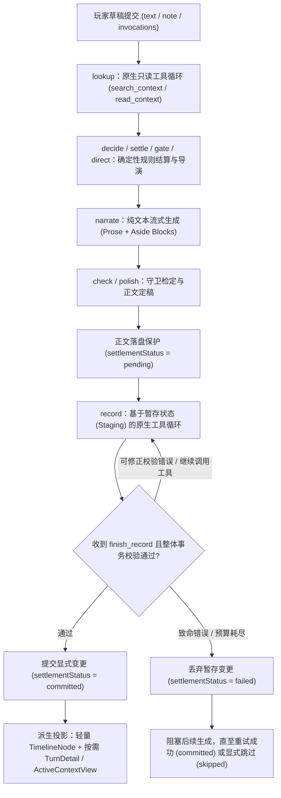

# effect-tavern 架构重构蓝图：原生工具运行时与受控状态事务

本设计文档旨在一次性打通 `packages/provider`、`packages/runtime`、`packages/server` 与 `packages/client` 的核心契约，彻底替换 PR `#151`、`#152`、`#153` 中为迁就旧接口而引入的伪工具协议、墓碑值编码与混杂目录，同时落地 Issue `#149`（渐进式披露与原生 Tool Calling）、`#150`（状态双轨核心打通与按需投影）与 `#154`（玩家调用目录与 Composer 统一草稿模型）。

> 本文档取代过渡期的 `docs/invoke-brief.md`、`docs/lookup-brief.md` 与 `docs/record-brief.md` 中关于“单次 `object()` 调用”、“不修改 `packages/provider`”、“`Turn.products` 墓碑编码”的临时假设。

---

## 1. 核心架构原则与边界

1. **保留确定性阶段编排，开放阶段内原生工具能力（Stage-Scoped Native Tools）**
   - 不将整个回合退化为无边界的自主 Agent。
   - **`narrate` 阶段保持纯净文本流**：不挂载任何 Tool，确保文学叙述语感与多轮 Prompt Cache 断点（`packages/provider/src/call.ts` `breakpoint()`）稳定。
   - **`lookup` 与 `record` 阶段升级为受控的原生工具循环**：基于 Vercel `ai` SDK 原生 `tools` 构建，由宿主阶段执行器（Stage Runner）掌控预算、串行副作用执行、显式完成校验与事务提交。
2. **废除临时实现约束，确立领域不变式**
   - 废除“单次 `object()` 调用”、“`Turn.products` 混装结果/补丁/`$delete` 墓碑”、“旧节点零迁移”、“伪 JSON 工具降级”等历史包袱。
   - 工具阶段直接要求连接具备原生 Tool Calling 能力。
3. **单轨彻底替换**
   - 在同一重构周期内按序完成四层替换，最终代码库只保留唯一一套运行路径。



---

## 2. 模块一：Provider 与阶段执行运行时（Stage Execution Runtime）

改造范围：`packages/provider/src/call.ts`、`packages/provider/src/connection.ts`

### 2.1 阶段执行原语与预算控制
在 `object`、`text`、`streamed` 之外，新增受控的阶段工具执行器 `runStageTools`：

```ts
export interface StageBudget {
  readonly maxSteps: number
  readonly maxOutputTokens?: number
  readonly timeoutMs?: number
}

export type StageOutcome<T> =
  | { readonly status: "completed"; readonly value: T; readonly trace: StageTrace; readonly usage: Usage }
  | { readonly status: "budget_exhausted"; readonly reason: string; readonly trace: StageTrace; readonly usage: Usage }
```

- **预算管理**：不再把“两三步必然足够”当作硬编码假设。执行器显式管理 `maxSteps`、`maxOutputTokens` 与 `AbortSignal`。当达到步数、时间或 Token 上限时，若阶段完成条件尚未满足，明确返回 `status: "budget_exhausted"`，绝不静默当成正常结束。
- **三级错误分类**：
  1. **参数或领域校验错误（Recoverable Validation Error）**：工具执行器捕获并返回结构化的 `{ ok: false, code, message }`（标记为 `isError: true`），作为 `tool-result` 消息喂回给模型，在剩余预算内让模型修正。
  2. **预算耗尽（Budget Exhausted）**：停止循环，丢弃未提交的暂存状态，返回明确原因。
  3. **致命故障（Fatal Error / Cancellation）**：网络中断、Provider 报错、存储异常或用户主动取消（Fiber Interruption），立即中止阶段并向上抛出 `ModelError`。

### 2.2 显式完成信号与确定性串行执行
- **串行执行与幂等性**：同一 step 内模型发出的多个工具调用，宿主**严格按调用列表顺序串行执行**。宿主按 `toolCallId` 记录执行结果，保证同一工具调用在重试路径下具备幂等性（不会重复创建实体或重复应用增量）。
- **显式完成信号（`finish_record`）**：
  - 在 `lookup`（只读检索）阶段：模型可根据工具返回内容继续多跳检索，当模型不再发起工具调用（或调用完成信号）时结束。
  - 在 `record`（状态事务）阶段：**不以“当前已发出的变更工具执行成功”作为阶段完成条件**（因为模型可能先查询或分步创建实体后再继续操作）。必须由模型显式调用原生完成工具 `finish_record({ notes, answers, ... })` 声明本阶段工作结束。
  - 若模型在同一 step 中同时发出了状态变更工具与 `finish_record`，`finish_record` 必须位于该 step 调用序列的末尾；宿主串行执行完前置变更工具后，在 `finish_record` 中对整体暂存事务（含必答项完整性、暂存状态约束、前置步骤是否存在未解决的错误）做最终校验：
    - 校验全部通过 ➔ 阶段完成，提交事务；
    - 校验未通过（或前置变更工具出错） ➔ `finish_record` 返回结构化错误，进入下一 step 供模型修正。

### 2.3 Schema 兼容性验证目标
- 工具定义统一由内部模块从声明编译为 JSON Schema。
- 将 Anthropic、Gemini 及 OpenAI-compatible 下的工具参数 Schema 兼容性与多步工具往返控制流列为 Step 1 的实测验证目标。

---

## 3. 模块二：统一状态树与 `record` 暂存事务（State & Transaction Model）

改造范围：`packages/runtime/src/product.ts`、`packages/runtime/src/derived.ts`、`packages/runtime/src/cond.ts`、`packages/runtime/src/session.ts`

### 3.1 显式声明 Product 职责（解耦 `feed` / `recall` / `fold`）
废除 `kindOf()` 通过 `feed` 与 `recall` 反向猜测产品职责的做法，在声明上显式区分三类领域角色：

| 角色 (`role`) | 领域语义 | 状态合入方式 | 模型上下文策略 |
| :--- | :--- | :--- | :--- |
| **`world`** | 世界当前状态（如 `scene`、`people`、`bag`） | 纳入统一 `WorldState`（支持 Record 字段合并或实体集合增删改） | 可配置常驻回喂（`Current:`）与/或纳入记忆检索 |
| **`chronicle`** | 编年史累积记录（如 `notes`） | 随路径按序追加（允许无新事实时为空） | 折叠前后的历史摘要与 `Known:` 账本 |
| **`theater`** | 面向玩家的演出副产物（如 `inner`、`options`、小剧场） | 仅归属单节点，不跨轮折叠 | 绝不回喂模型 |

### 3.2 稳定实体身份（宿主生成）与初始化规则
1. **稳定实体身份 `{ collection, entityId }`**：
   - **动态实体由宿主分配 ID**：模型调用 `insert_entity({ collection, data })` 时无需猜测或编造 ID，由宿主生成短而不透明的稳定 ID（如 `"e_k7m2"`），并通过工具结果 `{ ok: true, entityId: "e_k7m2", ... }` 返回给模型。
   - **卡片预置实体**：允许卡片作者声明固定 `entityId`，在卡片加载时校验唯一性。
   - **更新与删除**：模型在调用 `patch_entity` 或 `remove_entity` 时，必须使用从上下文、`search_context` 或前置 `insert_entity` 工具结果中获得的 `entityId`。
   - **删除后 ID 绝不复用**：实体被删除后，后续即使新建同名人物或同类物品（如第二把“木剑”），`insert_entity` 也会分配全新的 `entityId`，防止历史引用串号。姓名、称号、物品名等仅作为普通可变、可搜索属性（需要业务唯一性时另加校验约束，不承担内部身份）。
2. **取消“Turn 1 强制模型初始化”**：
   - 固定世界状态由卡片声明的初始值（`initial`）与开局确定性规则在会话创建时建立并校验。
   - 动态实体集合初始为空；允许未知的场景或属性显式建模为可缺省或未知，绝不为了通过校验强迫模型在第一轮脑补未登场的信息。

### 3.3 统一状态读取树（`WorldState`）与阶段时点边界
为解决 Issue `#150` 的状态双轨割裂，将确定性规则字段与 `world` 产品合成为统一的 `WorldState` 读取树：

```ts
export interface WorldState {
  readonly fields: Readonly<Record<string, number | string | boolean>> // 原 Rules.fields
  readonly world: Readonly<Record<string, unknown>>                    // 折叠后的 world products
  readonly lore: Readonly<Record<string, { since: number; shown: number; floor: number }>>
}
```

- **统一读取，隔离写入**：
  - `Cond`（`when`、`unlock`、`offer`）、模板展开（`{{...}}`）与状态面板共同读取 `WorldState`。
  - `fields` 仅允许确定性规则（`rpg.apply / fold / settleReadouts`）与玩家显式修订命令修改；`world` 仅允许 `record` 暂存事务与玩家显式修订命令修改。
- **严格的阶段时点（Stage Timing）**：
  1. 回合开始时，读取父节点已提交的 `WorldState_0`。
  2. `decide / settle` 在 `WorldState_0.fields` 上运行确定性动作，产出 `fields_1` 与 `events`。
  3. `gate / direct / narrate` 读取合成态 `{ fields: fields_1, world: WorldState_0.world }`。
  4. `record` 在 `narrate` 结束后，以 `WorldState_0.world` 为基底开启暂存事务，提交后产出 `WorldState_1 = { fields: fields_1 (+ readout answers), world: world_1 }`。
  5. **不倒流原则**：本轮 `record` 写入的 `world_1` 事实在回合提交后生效，绝不反过来改变本轮已经完成的 `gate` 或 `narrate` 判断。

### 3.4 `record` 暂存事务与显式领域变更（`DomainChange`）
持久化存显式的、经过校验的领域变更事件，彻底废除数据行内的 `$delete: true` 墓碑编码：

```ts
export type DomainChange =
  | { readonly kind: "replace"; readonly product: string; readonly value: unknown; readonly prev?: unknown }
  | { readonly kind: "patch_record"; readonly product: string; readonly patch: Record<string, unknown>; readonly prev?: Record<string, unknown> }
  | { readonly kind: "insert_entity"; readonly collection: string; readonly entityId: string; readonly data: Record<string, unknown> }
  | { readonly kind: "patch_entity"; readonly collection: string; readonly entityId: string; readonly patch: Record<string, unknown>; readonly prev: Record<string, unknown> }
  | { readonly kind: "remove_entity"; readonly collection: string; readonly entityId: string; readonly prev: Record<string, unknown> }
```

**事务校验规则：**
1. **`insert_entity({ collection, data })`**：校验 `data` 包含该集合声明的所有必填初始化列（含展示标题/钩子列）。宿主分配唯一 `entityId` 写入暂存集合，并返回 `{ ok: true, entityId }`。
2. **`patch_entity({ collection, entityId, patch })`**：要求 `entityId` 在当前暂存集合中**必须存在**，且 `patch` 至少包含一个定义的变更列。**更新不存在的 `entityId` 直接返回可修正错误，绝不隐式变成创建**。
3. **`remove_entity({ collection, entityId })`**：要求 `entityId` 在当前暂存集合中存在。从暂存集合中移除，并在 `DomainChange` 中记录被删前的完整快照 `prev`。
4. **`replace` / `patch_record`**：分别处理整体替换与 Record 结构的字段合并（显式区分缺省、清空与覆盖，不把 `set` 隐式解释为深合并）。
5. **按需暴露工具**：工具命名、Schema 编译和执行器集中在单一模块内，仅暴露当前阶段开启且满足 `when` 条件的集合/产品工具与 `finish_record` 工具。

### 3.5 四态结算状态机与未闭合节点阻塞规则
将正文落盘与状态事务提交解耦，每个回合节点维护明确的 `settlementStatus`：

| 状态 (`settlementStatus`) | 含义 | 能否作为父节点继续下一轮 |
| :--- | :--- | :--- |
| **`pending`** | 正文与确定性动作（`beats`）已保存，`record` 事务待执行或执行中 | **否** |
| **`failed`** | `record` 阶段失败或预算耗尽，暂存变更已全部丢弃 | **否** |
| **`committed`** | `record` 事务已通过校验并成功提交 | **是** |
| **`skipped`** | 玩家明确决定放弃本轮 `record` 结算 | **是** |

- **继续生成的前置条件**：当节点处于 `pending` 或 `failed` 时，玩家可以正常阅读正文、查看详情、切换分支或回到祖先节点创建新分支；但**若要从当前节点继续生成下一轮，必须先重试结算成功（转为 `committed`）或由玩家显式点击跳过（转为 `skipped`）**。
- **`skipped` 的精确语义与不可变性**：
  - 保留本轮已生成的正文与已完成的确定性动作结算（如 `decide / settle` 对 `fields` 的修改），仅放弃本轮 `record` 阶段的 `world` 更新、读数回答（`answers`）与 `notes`。
  - `skipped` 是明确终态。跳过后若玩家又想补做结算，系统通过创建修订分支（Sibling Node）执行，绝不原地篡改已有后代节点的祖先历史。
- **并发与过期提交保护**：每次执行或重试 `record` 时绑定唯一的 `attemptId` 与节点版本；若玩家在重试途中已点击 `skipped` 或编辑了正文，迟到的旧执行结果在提交校验时被直接拒绝。

---

## 4. 模块三：上下文四维模型、交付快照与 `lookup` 原生检索

改造范围：`packages/runtime/src/lore.ts`、`packages/runtime/src/derived.ts`、`packages/runtime/src/request.ts`

### 4.1 上下文资源的四维正交语义
废除将权限、激活方式与驻留周期混同的 `"always" | "auto" | "manual"` 枚举，在内部模型上明确区分四个正交维度：

| 维度 | 取值 | 职责说明 |
| :--- | :--- | :--- |
| **1. 归属 (`source`)** | `"card"` \| `"pack"` \| `"memory"` | 来自卡片设定、玩家挂载的写作包，还是故事运行中派生的实体记忆 |
| **2. 访问权限 (`access`)** | `{ model: boolean, player: boolean }` | 模型是否有权发现/读取？玩家是否有权在 Composer 目录中看到并手动调用？ |
| **3. 激活方式 (`activation`)** | `"always"` \| `"on_demand"` | 满足条件时自动装入请求，还是按需通过 `lookup` 工具 / 玩家手动调用装入 |
| **4. 驻留策略 (`residency`)** | `"permanent"` \| `"window"` \| `"turn"` | 装入后常驻、在活动窗口内保留，还是仅在当前回合请求有效 |

- **统一受解锁条件约束**：资源的 `unlock` 条件同时约束模型侧（`lookup` 索引、搜索与 `read_context` 校验）与玩家侧（`playerCatalog` 投影与手动调用校验）。未解锁的资源对模型和玩家均不可用。

### 4.2 统一冻结交付快照（`DeliverySnapshot`）
所有在本轮实际交付进上下文的资源（无论来自 `card`、`pack` 还是 `memory`），统一在节点上持久化不可变快照：

```ts
export interface DeliverySnapshot {
  readonly resourceId: string   // 如 "card:qingcheng" 或 "memory:people/e_k7m2"
  readonly revision: string     // 基于当前内容与解锁层级的确定性摘要 (Digest)
  readonly title: string        // 展示标题 / Hook
  readonly text: string         // 实际交付时的冻结正文
  readonly source: "card" | "pack" | "memory"
  readonly superseded?: string  // 若替代了窗口内的旧版本，记录旧 revision
}
```

- **保证交付内容可重放**：历史节点的详情展示与分支回放直接读取冻结的 `DeliverySnapshot.text`。即使后续外部写作包被卸载、卡片设定修改或实体属性在后续轮次更新，历史节点当时实际看过的文本证据也绝不改变或变为空串。

### 4.3 纯粹基于「实际请求装配驻留版本（`revision`）」的检索与去重
**彻底废除一切“根据实体创建轮次或最后写入轮次是否在窗口内来推断其是否已驻留”的假设**（因为创建或更新所在轮次在窗口内，绝不代表正文包含了该实体的完整结构化字段）：

1. **状态更新合成完整快照**：每当 `memory` 实体创建或更新后，根据当前 `WorldState` 合成该实体的完整文本快照并计算确定性 `revision`。
2. **按阶段请求独立计算实际驻留集合**：
   - 驻留状态**仅由目标阶段实际装配进请求（Request Assembly）的资源版本决定**：包括该请求中实际携带的活动窗口 `DeliverySnapshot`、明确完整注入 `Current:` 的数据、以及当前阶段内已经由工具返回给模型的版本。
   - **阶段间隔离**：`lookup` 阶段读取了某资源，是因为其结果将被纳入本轮交付集合进而装入后续的 `narrate` 请求；驻留判定严格针对具体请求实际包含的 `(resourceId, revision)`。
3. **版本驱动的检索与读取**：
   - 只要某资源的**当前最新 `revision` 未实际驻留在目标上下文中**，它就允许被检索和读取；
   - 曾经读取过但对应 `DeliverySnapshot` 已滑出活动窗口的资源，其 `revision` 不再驻留，自动恢复可读；
   - 若旧版本 `v1` 仍驻留在活动窗口内，而实体已更新为 `v2`（`v2 !== v1`），则 `v2` 允许被检索和读取，并在新交付快照中标记 `superseded: "v1"`，在请求中明确其对旧版本的替代关系。

### 4.4 `lookup` 原生只读工具集
删除 `Lookup(remaining, catalog)`、`more`、`search` 字段与 `Read / Found / lookup.again` 拼接协议，提供小型稳定的原生工具：
- `search_context({ query: string, scope?: "all" | "card" | "pack" | "memory" })`：
  - 支持中英文多词切分检索；
  - 仅在已解锁、`access.model === true`、`activation === "on_demand"` 且**当前最新 `revision` 未驻留**的资源中检索（**读过旧版本的实体，其新版本仍可被搜出**）；
  - 返回受控数量的 Top-K 摘要 `{ resourceId, title, source, supersedes?: string }`。
- `read_context({ refs: string[] })`：
  - 校验资源存在性、解锁条件与 `access.model` 权限；
  - 合法则返回最新冻结正文并记入本轮待交付列表；非法则返回结构化错误供模型修正。

---

## 5. 模块四：前后端契约与客户端交互（含 `#154` 闭环）

改造范围：`packages/server/src/turn.ts`、`packages/client/src/readings.tsx`、`packages/client/src/record.ts`、`packages/client/src/composer.tsx`、`packages/client/src/inspector.tsx`

### 5.1 轻量时间线节点 + 按需详情与状态投影
持久化层完整保存交付快照与领域变更，但传输契约按职责分层，防止长局历史树拖垮内存与首屏加载（对齐 `#150`）：

| 契约类型 | 加载时机 | 包含内容 |
| :--- | :--- | :--- |
| **`TimelineNode`（轻量）** | 会话树加载 / 新回合推送 | `id`, `parent`, `input`, `prose`, `theater`, `heading`（服务端派生）, `settlementStatus`, `deliverySummary`（仅 `{ resourceId, title, source, revision }`，不含正文）, `changeSummary`（是否存在变更及轻量计数，不含全量快照） |
| **`TurnDetail`（按需）** | 展开某回合 Record Sheet / 线索面板时按节点 ID 读取 | 该回合的完整 `checks`、完整 `DeliverySnapshot[]`（含冻结 `text`）、字段变更明细与完整 `DomainChange[]`（含 `data` / `patch` / `prev`） |
| **`ActiveContextView`（当前选中节点）** | 当前活跃分支头部（或切换分支/打开状态页时获取） | `worldState`（当前完整 `fields` 与 `world` 实体集合）、`playerCatalog`（当前分支上可供玩家手动调用的目录） |
| **`InspectorTrace`（按需）** | 打开 Inspector 查看某节点时按需读取 | 该节点各阶段的请求消息、原生 Tool Calls / Results 序列、预算消耗、耗时与 Token 明细 |

**客户端职责边界：**
- 状态恢复、补丁合并、祖先链标题推导全部收归服务端 Runtime；
- 客户端彻底删除跨包导入的 `fold()`、`packages/client/src/readings.tsx` 中的 `$delete` 判断与 `packages/client/src/record.ts` 中的祖先链遍历；保留纯展示层的本地排序、筛选与格式化。

### 5.2 玩家调用目录与 `#154` Composer 统一草稿模型
1. **专供玩家的 `PlayerCatalogItem`**：
   - 仅投影已解锁且 `access.player === true` 的资源，包含 `{ resourceId, title, category, source, summary, available }`，与模型内部剧情检索目录彻底解耦。
2. **Composer 统一草稿模型（`DraftModel`）**：
   - 统一管理 `{ text: string, note: string, invocations: InvocationToken[] }`。
   - 实现 `#154` 的资产分层多级弹出面板与输入区内联调用 Token，统一处理选择、退格撤销、发送失败恢复与跨会话草稿保存。

---

## 6. 五条核心业务流程端到端推演（设计检验）

### 流程 1：局部更新后重读（Partial Update & Re-read）
1. **Turn 3**：李鹤登场，`record` 调用 `insert_entity({ collection: "people", data: { name: "李鹤", role: "青城弃徒", stance: "警惕" } })`，宿主分配 `entityId: "e_k7m2"`，合成实体快照 `revision: "v1"`，最后调用 `finish_record` 提交。
2. **Turn 15**：剧情中李鹤态度转变。`record` 调用 `patch_entity({ collection: "people", entityId: "e_k7m2", patch: { stance: "盟友" } })` 并调用 `finish_record`。状态模块将其与 `"v1"` 合并为完整实体 `{ name: "李鹤", role: "青城弃徒", stance: "盟友" }`，计算得 `revision: "v2"`。
3. **Turn 16**：请求装配器检查当前活动上下文中实际驻留的资源版本，发现 `("memory:people/e_k7m2", "v2")` **并未驻留**（无论 Turn 3 或 Turn 15 在不在原文窗口中，只要 `"v2"` 未通过 `Current:` 或 `DeliverySnapshot` 实际驻留，即为未驻留）。因此 `memory:people/e_k7m2`（`"v2"`）在 Turn 16 可被 `lookup` 检索并读取，完整带回“青城弃徒 + 盟友”的合成快照（若窗口内曾读过 `"v1"`，则标记 `superseded: "v1"`）。

### 流程 2：删后重建（Delete & Recreate without ID Reuse）
1. **Turn 8**：道具“木剑”（`entityId: "e_s101"`）损毁，`record` 调用 `remove_entity({ collection: "bag", entityId: "e_s101" })` 并 `finish_record`。`WorldState.world.bag` 移除 `e_s101`；`TurnDetail.changes` 记录 `{ kind: "remove_entity", collection: "bag", entityId: "e_s101", prev: { name: "木剑", durability: 0 } }`。
2. **Turn 12**：玩家获得另一把新木剑。模型若尝试 `patch_entity({ collection: "bag", entityId: "e_s101", ... })`，暂存事务返回可修正错误 `"entity e_s101 does not exist"`。模型调用 `insert_entity({ collection: "bag", data: { name: "木剑", durability: 10 } })`，宿主分配**全新 ID `"e_s209"`**，与旧木剑 `e_s101` 的历史引用彻底隔离。

### 流程 3：`record` 失败阻塞与重试/跳过（Settlement State Machine）
1. **Turn 10**：`narrate` 与 `check` 完成，正文保存落盘，节点进入 `settlementStatus = "pending"`。随后 `record` 因达到 `maxSteps` 仍未收到通过校验的 `finish_record` 而终止，暂存变更全部丢弃，节点转为 `settlementStatus = "failed"`。
2. 此时玩家可阅读 Turn 10 正文或切回 Turn 9 开新分支，但**从 Turn 10 继续发送下一轮被阻塞**。
3. 玩家点击 **[重试结算]**（生成新 `attemptId` 仅重跑 `record` 成功后转为 `committed`）或点击 **[跳过结算]**（保留正文与本轮已生效的 `decide/settle` 规则字段变更，放弃本轮 `record` 更新，节点转为终态 `skipped`），解除阻塞后即可继续下一轮。

### 流程 4：切分支（Branching / Swipe / Reword）
1. 玩家在 Turn 10 点击 Swipe 或回到 Turn 6 创建新分支。
2. Runtime 沿新分支祖先链折叠 `WorldState` 并统计实际驻留的 `(resourceId, revision)`。
3. 兄弟分支上的 `DomainChange` 与 `DeliverySnapshot` 完全隔离；切回旧分支时，旧节点上冻结的 `DeliverySnapshot` 原样呈现。

### 流程 5：纯调用输入（Chip-Only Input）
1. 玩家在 Composer 中未输入文字，仅选择调用项 `{ text: "", invocations: ["pack:wuxia-fight"] }` 发送。
2. 系统校验该资源对玩家可调用且已解锁，注入上下文并冻结 `DeliverySnapshot`；在对话历史与账本中生成合法的用户轮次边界；完整执行 `narrate -> check -> record` 并计入有效互动轮数；后续对该轮执行 `edit` 时正常走 `check` 与 `record`。

---

## 7. 四步落地计划

| 步骤 | 交付范围 | 关键验收标准 |
| :--- | :--- | :--- |
| **Step 1：原生阶段执行层** | `packages/provider` 阶段工具运行时、串行工具执行与 `toolCallId` 幂等、三级错误分类、预算控制、`StageTrace` 采集 | 支持显式完成信号、可修正错误回传、预算耗尽终止、取消信号中断；验证三家 Provider 格式下的工具 Schema 与消息往返 |
| **Step 2：统一状态树与 `record` 事务** | `Product` 显式职责、宿主生成 `entityId`、`WorldState` 统一读取树、`DomainChange` 暂存事务 + `finish_record`、四态结算状态机（`pending/failed/committed/skipped`） | 删后重建 ID 不复用、无 `$delete` 墓碑、`Cond` 可读 `world` 状态、未闭合节点阻塞后续生成且支持重试/跳过 |
| **Step 3：四维上下文与 `lookup` 检索** | 四维资源模型（`source/access/activation/residency`）、全量冻结 `DeliverySnapshot`、纯请求级 `revision` 驻留去重、`search_context` / `read_context` 工具 | 局部更新后可重读新版本、大目录请求体积受控、卸载外部包不影响历史回放、模型与玩家目录同受 `unlock` 与 `access` 约束 |
| **Step 4：客户端按需契约与 `#154` Composer** | 轻量 `TimelineNode` + 按需 `TurnDetail` / `ActiveContextView` / `InspectorTrace`、客户端移除状态恢复逻辑、落地 `#154` Composer 多级菜单与统一草稿 | 前端零 `fold()` / 零 `$delete` / 零祖先遍历；时间线加载轻量；Composer 完整闭环 `#154` |
